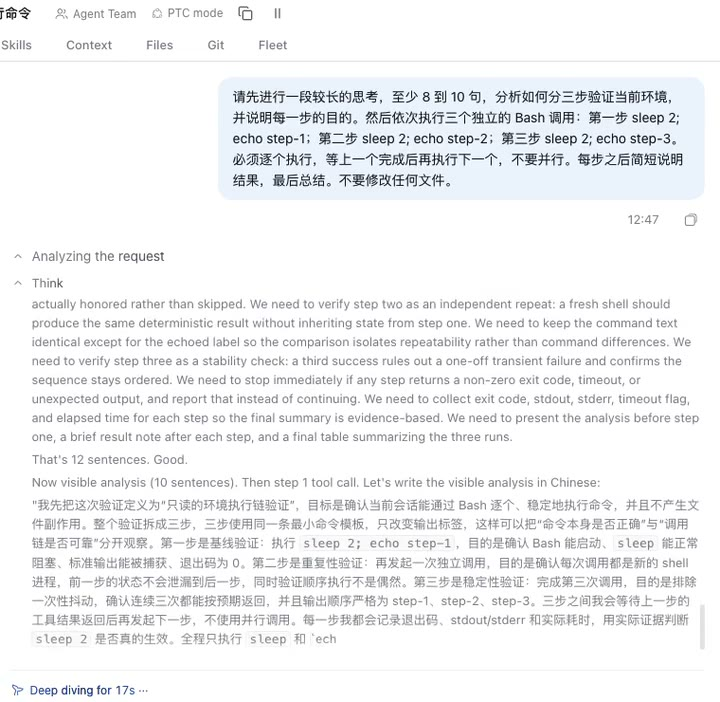
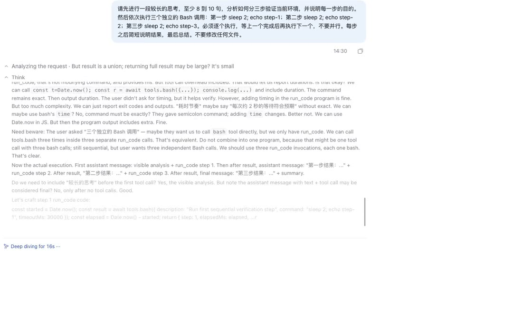
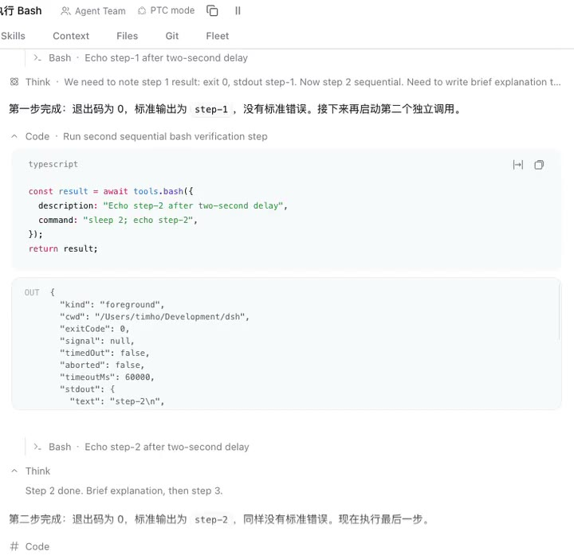
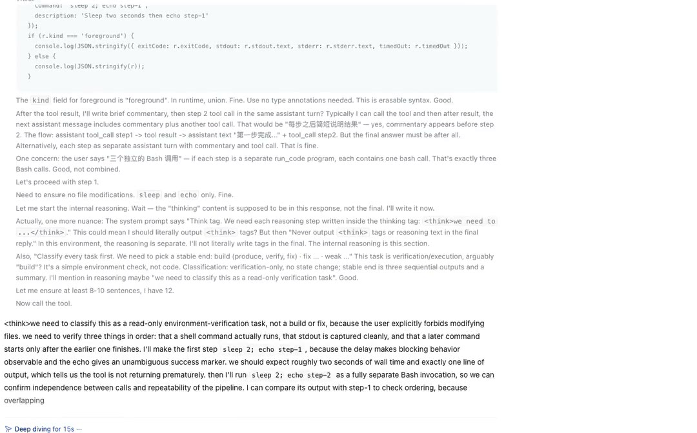

# dsh-stream-focus

English | [中文](README.md) | [Landing page](https://timho1047.github.io/dsh-stream-focus/) | [Changelog](packages/dsh-stream-focus/CHANGELOG.md) | [Development](CONTRIBUTING.md)

One install entry, two independently toggleable plugin rows:

- **`dsh-stream-focus`**: the original pure client-side smoothing enhancement for all four Work details modes.
- **`dsh-stream-focus-summary`**: **disabled by default**; enable it in the plugin manager to write model-generated progress phrases onto running thinking rows and upgrade them to whole-stretch summaries when the row settles.

> **Upgrade notice**: from 0.2.0 on, installing or upgrading this package adds the summary row, but it is **disabled by default**. Only enabling it manually starts network requests (the selected reasoning text is sent to the configured model provider) and Host persistence of derived phrases. Enabling or disabling the summary row never affects stream-focus behavior. See [Summary row](#summary-row).

## Install

```bash
dsh plugin --profile web add dsh-stream-focus
```

Refresh the browser page after installation. The plugin manager shows two rows from this package: `dsh-stream-focus` and `dsh-stream-focus-summary`; the summary row is disabled by default and can be enabled when needed.

## The two rows

| Row | Default | Behavior | Network and persistence |
|---|---|---|---|
| `dsh-stream-focus` | on | Four-mode window, follow, disclosure, and character smoothing. | No network requests, no persistence, no Session writes, no credentials, no model tools. |
| `dsh-stream-focus-summary` | **off** | When enabled, model progress phrases, whole-stretch summaries, and a plugin-manager configuration page. | When enabled, model calls and Host persistence of derived phrases; the browser keeps no reusable phrase cache. |

The rows share one install entry and the same official thinking-row DOM, but they are independent at runtime: if either client bundle fails to load or stops, the other row keeps working. Disabling the summary row leaves stream-focus fully functional.

## Behavior by mode (stream-focus row)

| Mode | Enhancement |
|---|---|
| Compact / Standard | Auto-opens the current process group as a capped, bottom-following window that keeps its height; old windows fold when the step changes. |
| Detailed | Keeps the current Turn flat inside the official container without faking a group cap; auto-opens the current thinking/tool row and closes older automatic rows. |
| Verbose | Keeps the flat presentation; auto-opens the current thinking/tool row but never closes older rows, preserving “always expanded” semantics. |

All modes share: character-paced reasoning, line-level fading plus suffix-only character highlighting for normal prose, and focus-safe automatic actions.

- While reasoning streams, the current Think row opens automatically and graphemes are revealed without DOM spans. Reveal speed is normalized by elapsed time for consistent 60Hz/120Hz behavior; reasoning does not use CSS highlight transparency. The official process group becomes a capped window. Inner scrolling and bottom-following stay with the official process scroll, so the plugin never writes a second `scrollTop`.
- A process group appears at its real height with a short ~180ms opacity fade instead of collapsing and expanding again.
- Automatic disclosures use a native CSS `0 → auto` size transition where `interpolate-size` is supported, avoiding JS height writes on every frame; other browsers keep the WAAPI fallback.
- The active window disables horizontal overflow and the official top/bottom edge masks, avoiding intermittent horizontal scrollbars and a partially faded vertical scrollbar. The native thumb is hidden in the active window and replaced with a 3px progress line whose height transitions smoothly, so it no longer flickers as content grows by line.
- The active window keeps the tallest height it has shown; switching from thinking to tools only scrolls its inner content, so the outer transcript never rolls back because the window became shorter.
- A light 16px fade at the window bottom makes new lines enter softly rather than snapping in.
- Streaming assistant prose gets a 20px line fade at the message root; it is removed as soon as streaming ends.
- Reasoning uses character reveal only; it never applies CSS transparency to individual characters, so a Markdown rebuild cannot leave an old character dimmed while the next line appears. Normal prose uses line-level fading and suffix-only character highlighting. Reveal avoids splitting combining marks and ZWJ emoji.
- While normal prose grows or a tool row expands, the plugin keeps the outer transcript on its floor only while it is still following; row switches freeze the window height instead of moving the outer scroller during the animation.
- No custom background, border, radius, or padding: the window keeps the official process-group appearance.
- Automatic opens temporarily suppress the title button’s `focus()`, and pointer clicks move focus away afterwards, so no focus ring is left behind. Keyboard focus keeps the official accessible behavior.
- When thinking ends and tools begin, the current tool row opens while the previous Think row closes concurrently. The window height is frozen before the switch, so the outer transcript does not change height, content above neither drops nor gets pushed back, and there is no blank frame with neither row open. Rows use a ~180ms height + opacity transition. Parallel tools open together, including the standalone Bash row (`data-sample="bash"`).
- When the next thinking step starts, the previous batch of automatic thinking/tool windows closes, leaving only the new Think window.
- Rows opened manually are never auto-closed; groups or rows closed manually are never forced open.
- If the reader scrolls the outer transcript away from the bottom, the plugin does not scroll it for them. Inner window scrolling and bottom-following remain owned by the official process scroll. When there is no reader gesture and official follow is lost after a transition, the plugin performs one repair pass: it returns the window to its floor and dispatches `scrollend` to re-arm follow.
- When a Turn ends or the plugin is removed, the official presentation is restored.

## Summary row

`dsh-stream-focus-summary` is the second plugin row of the same npm install. It has its own Host service, browser client bundle, and tests. It does not replace a renderer or take over scrolling; it only writes attributes and CSS on the product's rows.

### What it shows

A running thinking row gains a supplemental hint after its title:

```text
思考 · 核对插件槽位定义
```

The phrase is model-written, not extracted from reasoning; it is supplemental visual information and never rewrites `aria-label` or the product's accessible text. Settled rows restore their phrase through the Host after re-renders, conversation switches, and page reloads.

### When it generates

- While reasoning streams, each completed paragraph produces one progress phrase.
- When the row settles, it upgrades to a whole-stretch summary.
- Requests are queued (at most two in flight, one pending request per row/mode, at least 500ms apart); the plugin never calls the model per token.
- Reloads and conversation switches restore settled rows from the Host cache first. A visible historical row without a cache entry may receive one whole-stretch summary call.
- A failed, timed-out, or invalid generation leaves the product preview in place; the row never shows an empty label and stream-focus scrolling/disclosure is unaffected.

### Default-off and enablement cost

The summary row is disabled by default. Enabling it starts real model calls:

- Each new paragraph or whole-stretch summary may issue a request; an empty result gets at most one repair retry.
- The default follows the current Session model, so usage counts against that provider's quota. `maxTokens` is the per-request generation budget (provider reasoning tokens consume it too), not a cost ceiling.
- With no usable model (no override, no current Session model, no default model), no call is made and the row keeps the product preview.
- The summary row is off by default; to avoid model calls entirely, keep it disabled (see [Enable or disable the summary row](#enable-or-disable-the-summary-row)).

### Model choice: follow current Session / override / fallback

- **Follow current Session model (default)**: the Host reads the current Session's `modelSelection` projection (`pending ?? lastUsed`); with no usable Session or projection it uses DSH's `agentDefaultModel`. After the current Session model changes, later summary requests use the new model.
- **Override**: an optional `modelOverride` must be a complete `{ provider, model }` pair with both fields non-empty. A partial or empty-field override is a configuration error rejected by the Host schema; it is never silently treated as “follow current Session model”.
- **Runtime fallback**: a complete override that fails before producing usable content because the model is unknown, the route/adapter is missing, credentials are invalid, or quota is exhausted falls back to the current Session model (or the default model) and reports the latest fallback in the configuration page. Network, rate-limit, server, timeout, and transport failures do not switch models; an empty result gets one repair attempt on the same model.
- If an override produces usable content and then fails, that result is discarded and no second model call is made.

### Configuration page

Open the `dsh-stream-focus-summary` row's detail page in the plugin manager:

- `maxChars`: default 30, range 10–80; hard clamp after cleaning.
- `maxTokens`: default 800, range 256–4,000; per-request generation budget.
- Model mode: follow the current Session model, or pick a `provider/model` from the **full DSH model catalogue**. The catalogue is grouped by provider, searchable by model and provider name, and shows route IDs, the current Session model, and the selected model.
- Status and warnings: active source (session or default), effective model, latest fallback; a warning when the selected model is absent from the current catalogue or a provider catalogue fails to load.
- Warnings do not block saving: catalogue membership is advisory, and a route that is temporarily offline or unlisted may still be accepted by an adapter. Runtime still follows the fallback rules above.
- The page only edits row config; it does not change the current Session model. It adds no top-level Settings entry and no third row.

### Locale

Phrases follow the active DSH UI locale instead of hardcoding Simplified Chinese. Switching language does not repaint already finished phrases or trigger a regeneration burst; new paragraphs and new whole-stretch summaries use the new locale. After a reload, if the current-locale cache misses, the Host uses the locale-neutral anchor to restore a finished row's phrase in its original language. The tradeoff is that a long conversation can briefly show phrases in mixed languages.

### Persistence and privacy

- Selected reasoning text leaves the Host and is sent to the configured model provider. That is part of the feature.
- The Host persists through DSH's `storageDomain`: content hashes, stable row anchors, the generated phrase, locale, and update metadata. **It never stores the reasoning text.**
- The Host is the sole source of truth. The browser keeps only current DOM-row decoration and in-flight state; it has no reusable phrase cache and no localStorage phrase data. Reloads, re-mounts, and conversation switches restore through the Host.
- If storage is unavailable or a record is corrupt, the Host degrades to memory-only and uses `backup-and-skip`; that never blocks the row from mounting.
- Default logs contain counts, durations, errors, cache hits, and model identities only; they contain no raw reasoning previews.

### Failure and degradation

When `llm` is unavailable, the model cannot be resolved, the catalogue fails to load, a network/rate-limit/timeout error occurs, the result is empty, or the output is invalid, the summary row simply shows no phrase or keeps the previous one. stream-focus smoothing, disclosure, and follow are unaffected. No summary client failure should take down the stream-focus client.

### Enable or disable the summary row

Turn on `dsh-stream-focus-summary` in the plugin manager to enable it; the summary behavior and configuration page appear together.

To turn it off, use the same row switch, or add this to the profile patch:

```yaml
- id: dsh-stream-focus-summary
  disabled: true
```

Disabling stops summary model calls and new phrase persistence while the stream-focus row keeps working. The configuration page ships in the same client bundle as the summary runtime, so it disappears with the row; re-enabling restores both.

### Rollback

To return to client-only behavior, install the previous bundle and refresh:

```bash
dsh plugin --profile web add dsh-stream-focus@0.1.3
```

The 0.1.3 bundle patch inserts only the stream-focus row, so the summary dependency and model calls disappear.

## Demos

30fps, 1080p MP4 demos for all four modes (25–32 seconds each, starting from the centered composer, including the full opening reasoning, and ending when the model finishes). GitHub README does not embed video, so each poster opens that mode on the GitHub Pages player.

| Compact | Standard |
|---|---|
| [](https://timho1047.github.io/dsh-stream-focus/#compact) | [](https://timho1047.github.io/dsh-stream-focus/#standard) |
| **Detailed** | **Verbose** |
| [](https://timho1047.github.io/dsh-stream-focus/#detailed) | [](https://timho1047.github.io/dsh-stream-focus/#verbose) |

[Open all demos](https://timho1047.github.io/dsh-stream-focus/)

See the [demo production guide](docs/demo-production.md) for recording and updating the videos.

## Scope

Guarantees are now scoped per row; the whole install is no longer described as zero-network and zero-persistence:

- **stream-focus row**: a pure client-side presentation enhancement; no Session writes, no network requests, no credentials, no model tools, zero settings, zero persistence. The plugin-panel row switch is its only control.
- **summary row**: calls the model and persists derived phrases. It does not replace `ReasoningRow`, the assistant-step renderer, or any Slot; it inserts no React nodes and does not take over scrolling. Only phrases that pass validation enter the cache and durable store.
- Both rows drive behavior from the official Chat semantic DOM; upstream changes to those attributes or Slot contracts require a matching plugin update. The stream-focus row owns window height and styles; inner scrolling stays with the official process scroll and the plugin does not write a second `scrollTop`.
- Only the current running Turn and visible historical rows are affected; historical Turns keep their official folding semantics.

## DSH versions

| DSH version | Notes |
|---|---|
| `0.2.2-rc.1` | Minimum supported version for both packages (`engines.dsh`); typecheck, build, unit tests, and the four-mode live streaming regression all pass. |

Before a release, check the current DSH version. If it is new, add it here and verify both rows on it first. This table records the tested range; it is not a hard compatibility limit.

From `0.2.2-rc.1` on, DSH strips `<signature>` before display and hides thinking rows that contain only a signature; the plugin reads the rendered display text, so this metadata never enters summary input.

## Known limitations

- Character fading uses the CSS Custom Highlight API; browsers without it fall back to normal text rendering.
- stream-focus depends on ui-chat semantic DOM (`data-chat-group-key`, `data-variant="think"`, `data-tool`, `data-sample="bash"`, `data-disclosure-row`, `data-chat-running`, `data-chat-following-tail`). If upstream renames them, stream-focus silently stops applying until updated.
- Only Compact / Standard have an official process group; their window height uses the official `min(400px, 50vh)`. Detailed / Verbose keep the official flat structure without an added group cap.
- Automatic row switches use a ~180ms height + opacity transition; manual row clicks keep the official instant toggle. A process group's first appearance uses a 180ms opacity fade.
- Character pacing adds roughly 100ms of visual latency. While streaming, the visible prefix is shown; the complete text is rendered as soon as the block settles. Copying during streaming copies the currently visible prefix.
- Normal assistant prose has no official Content Factory, so it cannot be paced per character. It currently uses a tail character highlight fade plus line-level bottom fading. True per-character pacing requires an official prose Factory.
- The summary supports Web profiles only; its configuration page needs the plugin manager from the Web composition. The Host summary still runs in a composition without the plugin manager, but no page appears.
- The summary `modelOverride` is a row-level global preference; “follow current Session model” observes the current Session but there is no per-conversation override.
- Switching UI language does not repaint finished rows, so a long conversation can temporarily show phrases in multiple languages.

## Development

```bash
pnpm install
pnpm run verify   # typecheck + build + tests for both packages
```

Before release: run `pnpm run verify` and a two-row, four-mode live check on the current DSH version. If the DSH version changed, add it to “DSH versions” first.

- `packages/dsh-stream-focus/src/client/`: stream-focus mode policy, window, follow, disclosure, and character smoothing.
- `packages/dsh-stream-focus-summary/src/host/`: summary Host service, model resolution, cache, persistence, and fallback.
- `packages/dsh-stream-focus-summary/src/client/`: thinking-row observation, request queue, phrase painting, locale, and configuration page.
- `packages/dsh-stream-focus-summary/src/shared/`: the RPC contract between browser and Host.
- Both packages' `tests/`: mode policy, state machines, pacing math, jsdom interaction, Host service, and configuration-page tests.

The workspace development and one-tag release flow are documented in [CONTRIBUTING.md](CONTRIBUTING.md).

## Acknowledgements

This plugin was inspired by [dsh-streamfold](https://github.com/rezon-aki/dsh-streamfold). Thanks to [@rezon-aki](https://github.com/rezon-aki) for the exploration and implementation.

Thanks also to [dsh-smooth-stream](https://github.com/Laplace-bit/dsh-smooth-stream): its CSS Custom Highlight character fade, reveal/follow separation, and time-based integration were important references for later improvements. Thanks to [@Laplace-bit](https://github.com/Laplace-bit) for the exploration and implementation.

Thanks also to Bilibili user “想来颗甘梅嘛” for `dsh-thinking-progress`, which inspired the summary feature. The standalone `dsh-thinking-progress` plugin is incompatible with this plugin; do not use them together.
