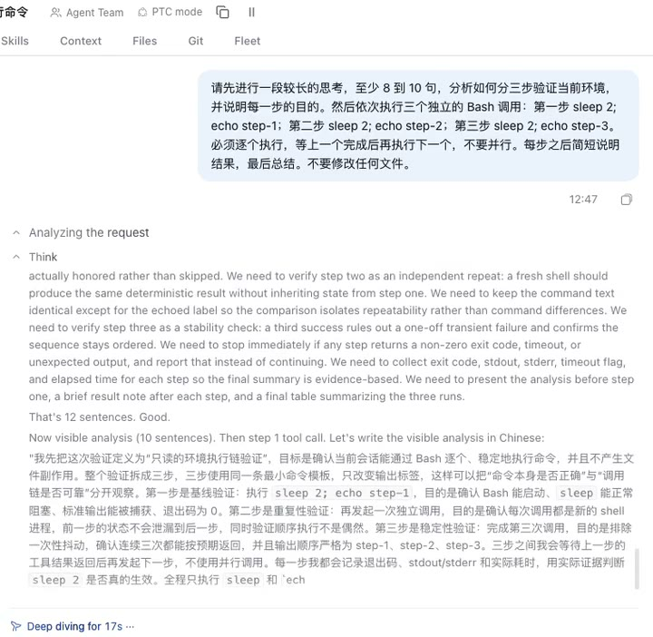
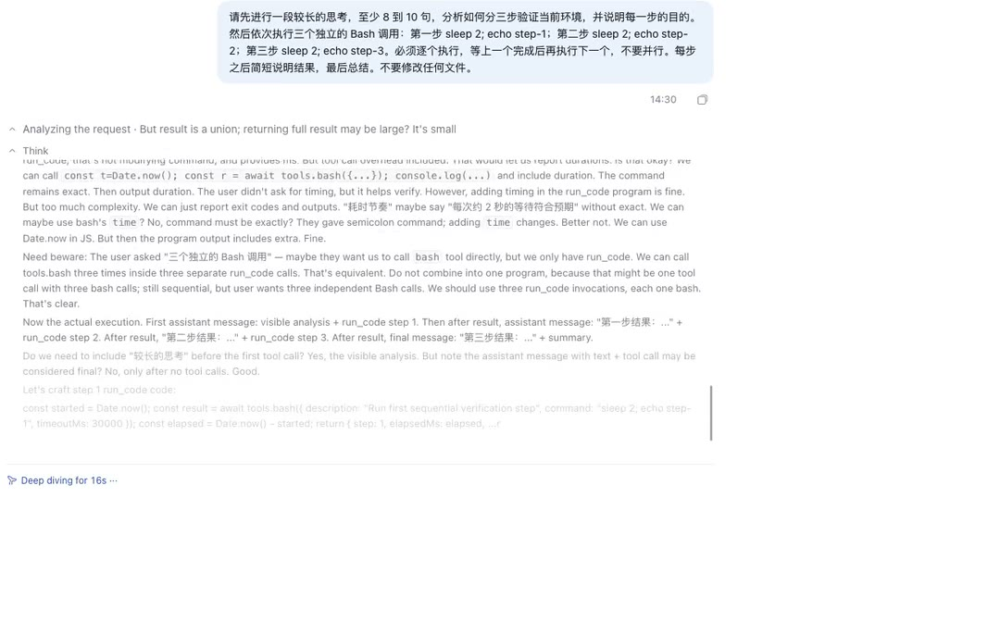
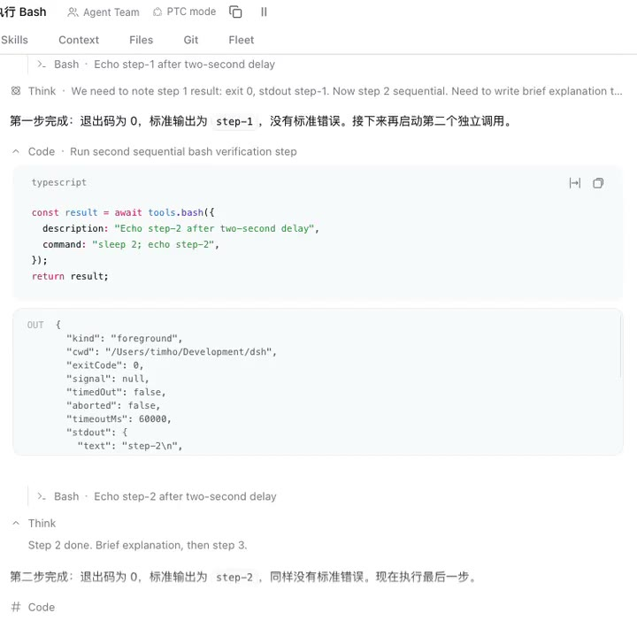
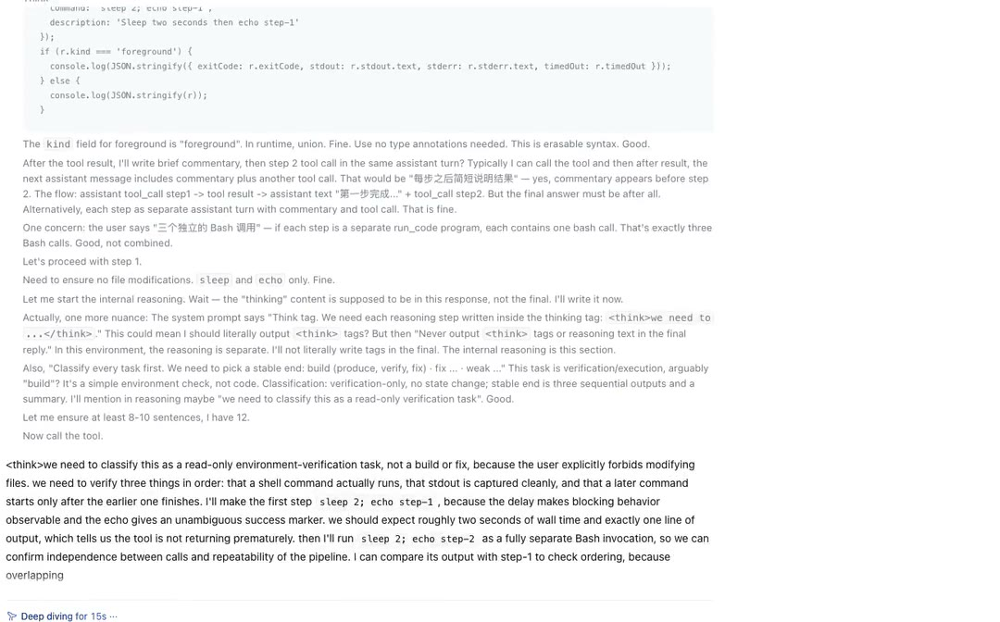

# dsh-stream-focus

[English](README.en.md) | 中文 | [Landing page](https://timho1047.github.io/dsh-stream-focus/) | [Changelog](CHANGELOG.md)

一个安装入口，两个可独立开关的插件行：

- **`dsh-stream-focus`**：四档工作步骤展示的纯客户端平滑增强（原有行为）。
- **`dsh-stream-focus-summary`**：**默认关闭**，需在插件管理器中手动启用；启用后为运行中的思考行生成模型进度短语，并在思考结束后升级为整段总结。

> **升级提示**：0.2.0 起，安装或升级本包会新增摘要 row，但它**默认关闭**。只有手动启用后才会产生网络请求（把选中的思考文本发送给配置的模型 provider），并由 Host 持久化派生短语。启用或关闭摘要 row 都不影响 stream-focus 的平滑行为。详见[摘要行](#摘要行)。

## 安装

```bash
dsh plugin --profile web add dsh-stream-focus
```

安装后刷新浏览器页面。插件管理器会出现两个来自本包的 row：`dsh-stream-focus` 和 `dsh-stream-focus-summary`；摘要 row 默认关闭，需要时在插件管理器中启用。

## 两个插件行

| 行 | 默认 | 行为 | 网络与持久化 |
|---|---|---|---|
| `dsh-stream-focus` | 开启 | 四档工作步骤展示的窗口、跟随、展开与字符平滑。 | 无网络请求、无持久化、不写 Session、不接触凭据、不注册模型工具。 |
| `dsh-stream-focus-summary` | **关闭** | 启用后提供思考行的模型进度短语、整段总结和插件管理器配置页。 | 启用后产生模型调用；Host 持久化派生短语；浏览器不保存可复用短语缓存。 |

两个 row 共享同一安装入口和同一套官方思考行 DOM，但运行期互不依赖：任一 row 的 client bundle 加载失败或停机，不会移除另一个 row 的行为。禁用摘要 row 后 stream-focus 继续工作。

## 各模式行为（stream-focus row）

| 模式 | 插件增强 |
|---|---|
| Compact / Standard | 自动展开当前过程组，形成限高、贴底、保持高度的运行窗口；切换行时自动收起旧窗口。 |
| Detailed | 当前轮次在官方容器内平铺，不伪造组级窗口；自动展开当前思考/工具行，并收起旧的自动展开行。 |
| Verbose | 平铺显示，自动展开当前思考/工具行，但不自动收起旧行，尊重“永远展开”的语义。 |

四档共享：思考正文逐字揭示、普通正文行级渐隐与尾部字符淡入、自动操作不抢焦点。

- 思考流式输出时，自动展开当前思考行；官方过程组本身成为限高、内部自动贴底的窗口。
- 思考正文用 CSS Custom Highlight API 对尾部新字素做透明度淡入，不插 span、不改 Markdown DOM；揭示速度按 elapsed time 归一化，60Hz/120Hz 手感一致。窗口内部滚动跟随使用官方 process scroll，插件不重复写 `scrollTop`，避免两套跟随互相抢滚动。
- 过程组首次自动展开时用约 180ms 的透明度淡入，窗口直接以真实高度出现，不再先折叠再展开。
- 自动展开/收起在支持 `interpolate-size` 的浏览器里使用 CSS `0 → auto` 尺寸过渡，不再由 JS 每帧写 height；不支持时回退到原有的 WAAPI。
- 运行中的窗口禁止横向溢出，并关闭过程组自带的上下渐隐遮罩，避免横向滚动条间歇出现、纵向滚动条被遮罩成半虚化。原生滚动条 thumb 在活动窗口内隐藏，右侧改用一条高度平滑过渡的 3px 进度线，避免内容按行增长时 thumb 一跳一跳地缩小。
- 活动窗口保持已经出现过的最大高度；思考切换到工具时只滚动内部内容，不再让外层会话因窗口变矮而回滚。
- 窗口底部有一层 16px 的轻渐隐，滚动跟随也更柔和，新行从底部淡入而不是硬切。
- 普通助手正文流式输出时，在消息根部加 20px 的底部行渐隐；输出结束后立即移除。
- 思考正文只使用逐字揭示，不再对字符做 CSS 透明度淡入，避免 Markdown 重渲染时旧字符延迟补出或跳字；普通正文使用行级渐隐与尾部字符淡入。逐字揭示会避开组合音标和 ZWJ emoji 边界。
- 普通正文增长或工具行展开时，插件只在外层仍处于跟随状态时维持尾部；行切换通过冻结窗口高度避免外层位移，不在动画期间反复改外层滚动。
- 不添加自定义背景、边框、圆角或内边距，窗口外观完全沿用官方过程组。
- 自动展开时临时屏蔽标题按钮的 `focus()`；鼠标点击标题后也会移走焦点，不留下焦点环。键盘聚焦保持官方的可访问焦点行为。
- 思考结束、工具开始后，当前工具行先展开，旧思考窗同时收起；切换前冻结窗口高度，外层总高度不变，上方内容不会下坠或被顶回，也不会出现两行都不展开的空白帧。展开/收起带约 180ms 的高度和透明度过渡。并行工具会一起展开，包括独立的 Bash 行（`data-sample="bash"`）。
- 下一次思考开始时，自动收起上一批自动展开的思考/工具窗口，只保留新的思考窗。
- 手动打开的窗口不会被自动收起；手动关掉的组或行不会被强行重开。
- 外层会话离开底部时不主动滚动；窗口内部的滚动与贴底由官方 process scroll 负责。若没有读者手势、过渡前窗口在底部而过渡后官方 follow 意外丢失，插件会做一次单次自愈：滚回窗口底部并派发 `scrollend` 重新激活 follow。
- 一轮结束或卸载插件后，恢复官方展示。

## 摘要行

`dsh-stream-focus-summary` 是同一个 npm 安装里的第二个插件 row，有自己的 Host 服务、浏览器 client bundle 和测试，不替换渲染器，也不接管滚动。它只读写产品行上的属性和 CSS。

### 显示什么

运行中的思考行标题会多出一段补充提示：

```text
思考 · 核对插件槽位定义
```

短语由模型生成，不是从 reasoning 中截取；它只作为视觉补充，不重写 `aria-label` 或产品的可访问文本。已完成行在重新渲染、切换会话和刷新页面后通过 Host 恢复短语。

### 什么时候生成

- 思考流式输出期间，每完成一个段落生成一条当前进度短语。
- 思考结束后，升级为整段思考的总结。
- 排队限制并发（最多两个在飞、每个 row/mode 只保留最新请求、请求间隔至少 500ms）；不会为每个 token 调用模型。
- 刷新或重新打开会话时优先从 Host 缓存恢复已完成行；靠近视口但没有缓存的历史行可能补一次整段总结调用。
- 生成失败、超时或输出不合法时保留产品自己的预览，不显示空标签；stream-focus 的滚动和展开不受影响。

### 默认关闭与启用成本

摘要 row 默认关闭；启用后会开始产生真实模型调用：

- 每次新段落或整段总结都可能发起一次请求；空结果最多再做一次修复重试。
- 默认跟随当前会话模型，成本计入该模型 provider 的额度；`maxTokens` 是单次请求的生成预算（provider 的 reasoning token 也占用这份预算），不是费用上限。
- 没有有效模型（既没有覆盖、也没有当前会话或默认模型）时不发起调用，行保持产品预览。
- 摘要 row 默认关闭；要完全避免模型调用，保持关闭即可（见[启用与禁用摘要行](#启用与禁用摘要行)）。

### 模型选择：跟随当前会话 / 指定模型 / fallback

- **跟随当前会话模型（默认）**：Host 读取当前 Session 的 `modelSelection` 投影（`pending ?? lastUsed`）；没有可用会话或投影时使用 DSH 默认模型 `agentDefaultModel`。切换当前会话模型后，后续摘要请求使用新模型。
- **指定模型**：可选 `modelOverride`，必须是完整的 `{ provider, model }` 对，两个字段都非空。只写一个字段或空字段是配置错误，由 Host schema 拒绝，不会静默回退成“跟随当前会话模型”。
- **运行期 fallback**：完整 override 在产生可用内容前因模型不存在、路由/adapter 缺失、凭据无效或配额耗尽等“该 override 不可用”的错误失败时，回退到当前会话模型（或默认模型），并在配置页显示最近一次 fallback。网络、限流、服务器、超时、传输中断等瞬态错误不切换模型；空结果先在同一模型上做一次修复重试。
- override 已经产生可用内容后才失败，丢弃该次结果，不自动二次调用。

### 配置页

在插件管理器中打开 `dsh-stream-focus-summary` row 的详情页：

- `maxChars`：默认 30，范围 10–80；清洗后的硬截断长度。
- `maxTokens`：默认 800，范围 256–4,000；单次生成预算。
- 模型模式：跟随当前会话模型，或从**完整 DSH 模型目录**中选择 `provider/model`。目录按 provider 分组，支持按模型名和 provider 名搜索，显示 route ID、当前会话模型和已选模型。
- 状态与警告：当前 active source（session 还是 default）、effective model、最近一次 fallback；已选模型不在当前目录、provider 目录加载失败时给出警告。
- 警告不阻止保存：目录成员关系是 advisory，暂时离线或未列出的 route 仍可能被 adapter 接受。保存后运行时仍按上面的 fallback 规则工作。
- 配置页只修改 row config，不修改当前会话模型；它没有独立顶层 Settings 入口，也不增加第三个 row。

### 语言

短语跟随当前 DSH UI locale，不再硬编码简体中文。切换语言不会重绘已经完成的短语，也不会触发一批重新生成；新的段落和新的整段总结使用新 locale。刷新后如果当前 locale 的缓存未命中，Host 会用 locale-neutral anchor 恢复已完成行的原语言短语。取舍是同一条长会话里可能短暂并存不同语言的短语。

### 持久化与隐私

- 选中的思考文本会离开 Host，发送给当前配置的模型 provider。这是摘要功能的一部分。
- Host 使用 DSH `storageDomain` 持久化：只保存内容哈希、稳定 row anchor、生成的短语、locale 和更新时间；**不保存 reasoning 原文**。
- Host 是唯一短语事实源；浏览器只保留当前 DOM 行的临时装饰和 in-flight 状态，没有可复用的短语缓存，也没有 localStorage 短语数据。刷新、重挂载和会话切换都通过 Host 查询恢复。
- 存储不可用或记录损坏时降级为 Host 内存缓存并使用 `backup-and-skip`，不会阻止 row 挂载。
- 默认日志只包含计数、耗时、错误、缓存命中和模型身份，不包含 reasoning 原文预览。

### 失败与降级

`llm` 不可用、模型无法解析、模型目录加载失败、网络/限流/超时、空结果或输出不合法时，摘要行只是不显示短语或保留旧短语；stream-focus 的平滑、展开和跟随不受影响。任何摘要 client 失败都不应拖垮 stream-focus client。

### 启用与禁用摘要行

在插件管理器的 row 开关里打开 `dsh-stream-focus-summary` 即可启用；启用后摘要行为和配置页一起出现。

关闭时在同一 row 开关里关闭，或在 profile patch 中写：

```yaml
- id: dsh-stream-focus-summary
  disabled: true
```

禁用后不再产生摘要模型调用和新的短语持久化，stream-focus row 继续工作。配置页与摘要 client 打包在同一份 bundle 中，因此禁用后配置页也会消失；重新启用 row 即恢复。

### 回滚

需要恢复纯客户端行为时，安装旧的 bundle 版本并刷新：

```bash
dsh plugin --profile web add dsh-stream-focus@0.1.3
```

0.1.3 的 bundle patch 只插入 stream-focus 一个 row，摘要依赖和模型调用随之消失。

## 演示

30fps、1080p 的四档 MP4 演示（每段 25–32 秒，从居中输入框开始，完整包含开场思考，并在模型输出结束后停止）。GitHub README 不支持内嵌视频，点击封面会打开对应模式的 GitHub Pages 播放页。

| Compact | Standard |
|---|---|
| [](https://timho1047.github.io/dsh-stream-focus/#compact) | [](https://timho1047.github.io/dsh-stream-focus/#standard) |
| **Detailed** | **Verbose** |
| [](https://timho1047.github.io/dsh-stream-focus/#detailed) | [](https://timho1047.github.io/dsh-stream-focus/#verbose) |

[打开全部演示](https://timho1047.github.io/dsh-stream-focus/)

录制和更新流程见 [演示视频制作流程](https://github.com/timho1047/dsh-stream-focus/blob/main/docs/demo-production.md)。

## 边界

以下承诺按 row 划分，不再把整个安装描述成“零网络、零持久化”：

- **stream-focus row**：纯客户端展示增强；不写 Session、不发网络请求、不接触凭据、不注册模型工具、零设置、零持久化。插件面板里启用/禁用该 row 就是它的总开关。
- **summary row**：会调用模型并持久化派生短语；它不替换 `ReasoningRow`、assistant-step renderer 或任何 Slot，不插入 React 节点，不接管滚动。只有通过校验的短语才会写入缓存和持久化存储。
- 两个 row 都读取官方 Chat 的语义 DOM 来驱动行为；官方改这些属性或 Slot 契约时，这里需要同步更新。窗口高度与样式由 stream-focus row 维护；内部滚动跟随使用官方 process scroll，插件不重复写 `scrollTop`。
- 仅对当前运行轮次和可见历史行生效；不修改历史轮次的折叠语义。

## DSH 版本

| DSH 版本 | 说明 |
|---|---|
| `0.2.2-rc.1` | 两个包的最低支持版本（`engines.dsh`）；typecheck、build、单元测试和四档真实流式回归均通过。 |

发布前检查当前 DSH 版本；如果遇到新版本，先在这里补充并完成两 row 实机验证，再发版。该表格记录实际验证范围，不代表只兼容这些版本。

从 `0.2.2-rc.1` 起，DSH 会在显示前剥离 `<signature>` 并隐藏只有签名的思考行；插件使用渲染后的显示文本，因此这些元数据不会进入摘要输入。

## 已知限制

- 普通正文的字符淡入依赖 CSS Custom Highlight API；不支持的浏览器会自动回退为普通文本渲染。思考正文不依赖该 API。
- stream-focus 依赖 ui-chat 的语义 DOM（`data-chat-group-key`、`data-variant="think"`、`data-tool`、`data-sample="bash"`、`data-disclosure-row`、`data-chat-running`、`data-chat-following-tail`）。上游属性改名时 stream-focus 会静默不生效，需要跟进。
- 只有 Compact / Standard 有官方过程组，窗口高度沿用其 `min(400px, 50vh)`；Detailed / Verbose 保持官方平铺结构，不添加组级限高。
- 插件自动切换行时，思考和工具行的展开/收起使用约 180ms 的高度 + 透明度过渡；手动点击行仍沿用官方即时切换。过程组首次出现使用 180ms 透明度淡入。
- 字符平滑会带来约 100ms 的视觉延迟；流式期间显示的是思考原文的可见前缀，结束后立即切回完整文本。复制正在流式输出的内容时会得到当前可见前缀。
- 逐帧 pacing 连续错过 3 帧时会自动退回 DSH 原生流式渲染；不会因为历史会话行数而提前降级。
- 普通助手正文没有官方 Content Factory，无法逐字 pacing；目前使用尾部字符 Highlight 淡入 + 行级底部渐隐。真正的逐字 pacing 需要官方增加一个正文 Factory。
- 摘要只支持 Web profile；配置页依赖 Web 组合中的插件管理器，没有插件管理器的组合里 Host 摘要仍可运行，但不会出现配置页。
- 摘要的 `modelOverride` 是 row 级全局偏好；“跟随当前会话模型”观察当前 Session，但不提供逐会话覆盖。
- 切换 UI 语言不重绘已完成行，因此长会话中可能暂时出现多种语言的短语。

## 开发

```bash
pnpm install
pnpm run verify   # 两个包的 typecheck + build + tests
```

发布前：在当前 DSH 版本上跑 `pnpm run verify` 和两 row 四档实机检查；如果 DSH 版本变化，先把新版本补进上方“DSH 版本”，再发布。

- `packages/dsh-stream-focus/src/client/`：stream-focus row 的模式策略、窗口、跟随、展开与字符平滑。
- `packages/dsh-stream-focus-summary/src/host/`：摘要 Host 服务、模型解析、缓存、持久化与 fallback。
- `packages/dsh-stream-focus-summary/src/client/`：思考行观察、请求队列、短语绘制、locale 与配置页。
- `packages/dsh-stream-focus-summary/src/shared/`：浏览器与 Host 之间的 RPC 契约。
- 两个包的 `tests/`：模式策略、状态机、节奏计算、jsdom 交互、Host 服务与配置页测试。

工作区开发与发布流程见 [CONTRIBUTING.md](../../CONTRIBUTING.md)。

## 致谢

本插件的开发受到 [dsh-streamfold](https://github.com/rezon-aki/dsh-streamfold) 的启发。感谢 [@rezon-aki](https://github.com/rezon-aki) 的探索与实现。

也感谢 [dsh-smooth-stream](https://github.com/Laplace-bit/dsh-smooth-stream)：它的 CSS Custom Highlight 字符淡入、揭示与跟随分离、基于时间的物理积分，为本插件的后续改进提供了重要启发。感谢 [@Laplace-bit](https://github.com/Laplace-bit) 的探索与实现。

也感谢 B 站用户“想来颗甘梅嘛”创作的 `dsh-thinking-progress`；本插件的摘要能力受其启发。旧的独立 `dsh-thinking-progress` 与本插件不兼容，不能同时使用。
